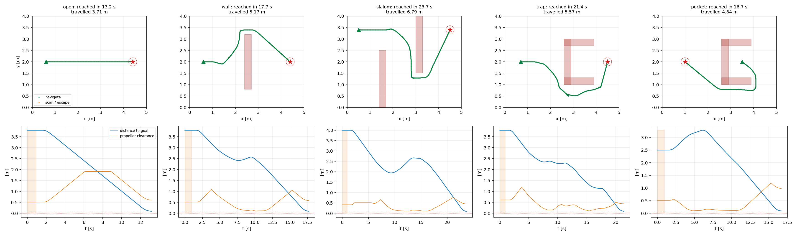

# Navigation simulation improvements

The simulation profile now learns a map from range measurements and plans
through it. It no longer relies on repeatedly escaping potential-field minima.
The flight profile keeps its previous controller and gains. No hardware was used.

## Measured results

On the 450-layout comparison, completion improves from **418/450 to 449/450**,
with observed collisions falling from **4 to 0**. One narrow-passage timeout
remains. The separate 100-layout delayed-sensor test completes **100/100**, with
no collisions.

| Controller | Reached | Collided | Timeout | Median successful time | Median successful distance |
|---|---:|---:|---:|---:|---:|
| Before: potential fields | 418 | 4 | 28 | 17.85 s | 4.52 m |
| After: sensor-built map | 449 | 0 | 1 | 15.40 s | 4.32 m |

Because the successful subsets differ, also compare the **418 layouts both
controllers completed**: median time decreases from 17.85 to 15.23 s (14.7%),
and median travel distance from 4.52 to 4.26 m (5.7%). These are changes in
the paired subsets' medians, not medians of individual percentage changes.

| Fixed scenario | Before time | After time | Before distance | After distance |
|---|---:|---:|---:|---:|
| Open | 11.45 s | 13.15 s | 3.65 m | 3.71 m |
| Wall | 67.60 s | 17.70 s | 14.18 m | 5.17 m |
| Slalom | 35.25 s | 23.65 s | 8.33 m | 6.79 m |
| Trap | 46.25 s | 21.40 s | 10.44 m | 5.57 m |
| Pocket | 74.10 s | 16.70 s | 16.97 m | 4.84 m |

Both versions complete these five fixed cases without collision. The mapped
controller also completes all 15 fixed sensitivity cases at 15 Hz, combining
sensor delay/response constants of 0/0.25 s, 0.1/0.5 s, and 0.2/0.75 s.
The separate 100-layout test uses seed 81, random initial headings, 15 Hz,
0.2 s sensor delay, and a 0.75 s response constant.

The remaining timeout is **seed 41, zero-based trial 5**, a cluttered layout
with a 25.9 cm passage. Its minimum propeller clearance is 3.47 cm; it does not
collide. The conservative grid cannot reliably exploit that narrow route.

Full measurements: [450-layout comparison](mapped_benchmark.json) and
[delayed-sensor evaluation](mapped_sensitivity.json).

## Controller

- Integrate the four 27-degree ranger cones into a 10 cm grid. A reading marks
  the cone interior as observed free and its short-range endpoint arc as a
  possible obstacle. Subsequent observations resolve the arc's ambiguity.
  Missing or invalid readings do not clear unknown space.
- Replan with A* every 0.5 seconds. Unknown cells may appear in the global plan,
  with a cost penalty, but movement requires observed space. When no route to
  the goal exists in the current map, explore reachable viewpoints bordering
  unknown space; accumulated visits discourage repeatedly trying the same one.
- Inflate obstacles and unknown space by the configured drone radius plus
  7 cm. Shortcuts check every crossed grid cell, including corner contacts.
  Bound speed using a local corridor that includes current momentum.
- If new evidence inflates over the current cell, retreat along short recorded
  segments that were previously traversed in observed free space. This avoids
  a deadlock where every command, including retreat, is rejected.
- Scan before entering blind wedges, taper speed near the goal, and require
  speed below 0.04 m/s as well as the arrival tolerance before reporting success.

Only ranges, scan acquisition pose, current pose/velocity, goal, and footprint
configuration reach the controller. Room bounds and obstacle coordinates are
used exclusively by the simulator and collision evaluator. The cruise speed
remains 0.35 m/s. Existing potential-field tuning options apply to
`--navigation reactive`; mapped navigation uses speed, goal tolerance, and yaw
sweep settings.

## Simulator and evaluation

The ranger now evaluates the continuous cone against rectangles. The previous
seven-ray approximation could miss a thin obstacle *within* a cone; blind
wedges between cones remain unsensed. The sampled model is still available via
`simulate_ranger(..., rays_per_beam=7)` for comparison.

Position and velocity use the exact first-order response to a held command.
Delayed ranges are paired with their acquisition position and yaw rather than
being inserted into the map at the current position. The log includes the
terminal sample at the exact time limit, swept footprint clearance, travel
distance, and travel distance divided by straight-line start-to-goal distance.
That ratio is not a comparison against an optimal obstacle-avoiding path.

The before/after comparison runs both controllers in this same revised
simulator: 20 Hz, 0.25 s velocity-response constant, 9 cm drone radius, and a
120 s time limit. It uses 150 random layouts per seed for seeds 7, 41, and 2026.
The first 50 layouts of seed 7 were used during development; these are empirical
regressions, not a claim of general completeness. Random failures are retained,
not filtered out on an assumed reachability criterion.

The baseline is `algorithms/reactive_nav.py` from commit
`35811c9f2d260708761b4ab768d3363b287426c4`, Git blob
`f25f679772edf30199a2bed236eb2bfeccee4d29`. JSON artifacts contain source SHA-256
hashes, each trial's outcome, time, distance, clearance, seed, and index.
Historical reports used different simulator behavior and should not be mixed
with these numbers.

## Validation and limitations

All 24 navigation regression tests pass. They cover the fixed scenarios with
both profiles, delayed sensing and velocity lag, thin obstacles, a 60 cm gap,
unreachable goals, corner clipping, blocked-cell recovery, missing readings,
settled arrival, and the analytic cone and motion models. A separate three-wall
maze completed in 45.95 s without collision. The saved trajectory plot was
rendered and visually inspected.

The model still assumes static rectangular obstacles and accurate odometry.
Free-space evidence persists, so moving obstacles and noisy/drifting scans
need a different map update policy. The 10 cm grid and inflation can reject
physically traversable narrow gaps. The workspace extends 5 m beyond the
start/goal bounding box and does not grow. Motion checks are local heuristics,
not a formal braking guarantee for arbitrary speeds, lag, or loop periods.
Collision evaluation sweeps each integration step's displacement segment.

Mapping adds computation and memory compared with the field controller; the
improvement measured here is navigation efficiency. JSON `wall_seconds` records
batch runtime, but concurrent jobs make it unsuitable as a controlled CPU
benchmark. The open scenario takes longer because scanning and settled arrival
add overhead. Neither successful trials nor zero observed collisions establish
performance outside the tested simulation model.

## Reproduce

```bash
uv sync
uv run python -m unittest algorithms.test_reactive_nav -v
uv run python algorithms/reactive_nav.py --scenario all --save docs/reactive_nav/mapped_runs.png

git show 35811c9f2d260708761b4ab768d3363b287426c4:algorithms/reactive_nav.py > /tmp/reactive_nav_before.py
uv run python dev_scripts/benchmark_reactive_nav.py \
  --baseline /tmp/reactive_nav_before.py --profiles sim \
  --seeds 7 41 2026 --trials 150 \
  --output docs/reactive_nav/mapped_benchmark.json

uv run python dev_scripts/benchmark_reactive_nav.py \
  --profiles sim --seed 81 --trials 100 --random-yaw \
  --dt 0.06666666666666667 --tau .75 --sensor-delay .2 \
  --output docs/reactive_nav/mapped_sensitivity.json
```

Use `--navigation reactive` to run the previous algorithm with the simulation
gains, or `--profile flight` to evaluate its existing flight gains offline.


